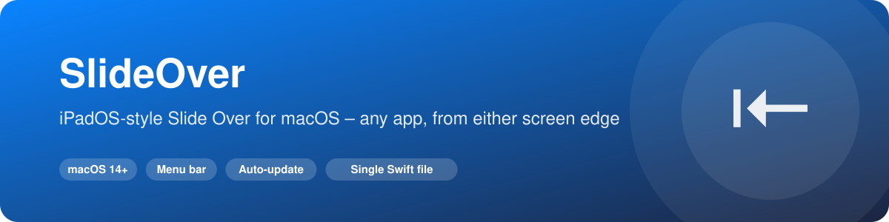
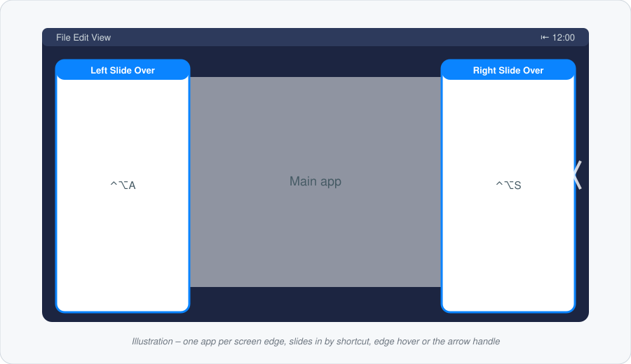

# SlideOver

[English](README.md) · **Deutsch**

[](https://github.com/dr-apple/SlideOver/releases/latest)



**Slide Over** wie auf dem iPad für macOS – eine winzige Menüleisten-App, mit der jede Mac-App vom Bildschirmrand hereingleitet, genau wie auf dem iPad.



## Funktionen

- **Zwei Slide-Over-Apps – eine pro Seite**: eine App für den linken und eine für den rechten Rand
- Jede gleitet mit Animation von ihrem Rand herein und wieder hinaus
- Merkt sich **Position und Größe pro Seite und App** – Fenster einfach verschieben/vergrößern, es kommt genau dort wieder
- **Pfeil-Griff** am Bildschirmrand (wie auf dem iPad), wenn Slide Over weggeschoben oder verdeckt ist – er blendet sich nur ein, wenn die Maus in die Nähe des Rands kommt, und nie über Vollbild-Apps (z. B. Videos); Klick holt die App zurück
- Optional: einblenden, wenn die Maus kurz am Bildschirmrand verweilt (~0,3 s; Ecken ausgenommen, damit aktive Ecken weiter funktionieren; über Vollbild-Apps aus)
- Optional: automatisch ausblenden, wenn du zu einer anderen App wechselst
- Startet die App, falls sie noch nicht läuft
- **Startet bei der Anmeldung** (standardmäßig an, im Menü umschaltbar) und merkt sich beide Apps, Positionen und Größen über Neustarts hinweg
- **Automatische Updates**: prüft beim Start und alle 6 Stunden die GitHub-Releases, lädt herunter, ersetzt sich selbst und startet neu (im Menü abschaltbar)
- Keine Abhängigkeiten, eine einzige Swift-Datei, kein Xcode-Projekt nötig

## Tastenkürzel

| Kürzel | Aktion |
|---|---|
| `⌃⌥⇧S` | Vorderste App zur **rechten** Slide-Over-App machen (und einblenden) |
| `⌃⌥S` | **Rechtes** Slide Over ein-/ausblenden |
| `⌃⌥⇧A` | Vorderste App zur **linken** Slide-Over-App machen (und einblenden) |
| `⌃⌥A` | **Linkes** Slide Over ein-/ausblenden |

Alles andere (Apps pro Seite, Größe, Griff, Rand-Auslöser, automatisches Ausblenden, Updates) steckt im Menüleisten-Symbol.

## Installieren

**Fertige App:** ZIP unter [Releases](https://github.com/dr-apple/SlideOver/releases) laden, `SlideOver.app` nach `~/Programme` (bzw. `~/Applications`) ziehen und einmal ausführen:

```bash
xattr -dr com.apple.quarantine ~/Applications/SlideOver.app
```

(Die App ist nicht von Apple beglaubigt.)

**Selbst bauen:** macOS 14+ und die Xcode Command Line Tools (`xcode-select --install`):

```bash
./build.sh install
```

Das baut `SlideOver.app`, kopiert sie nach `~/Applications` und startet sie.

Beim ersten Start den Zugriff auf **Bedienungshilfen** erlauben (Systemeinstellungen → Datenschutz & Sicherheit → Bedienungshilfen). Die App braucht ihn, um Fenster anderer Apps zu verschieben und zu vergrößern.

> **Hinweis:** Die App ist ad hoc signiert, deshalb hält macOS sie nach jedem Update/Neubau für eine neue App. Nach einem automatischen Update setzt SlideOver seinen Bedienungshilfen-Eintrag selbst zurück, damit macOS erneut fragt – einfach erlauben. Nach einem manuellen Neubau den SlideOver-Eintrag unter Bedienungshilfen mit „–“ entfernen, neu starten und erneut erlauben.

## Beispiel: typische Einrichtung

1. **Nachrichten** öffnen und `⌃⌥⇧A` drücken – Nachrichten wird die linke Slide-Over-App.
2. **Musik** öffnen und `⌃⌥⇧S` drücken – Musik wird die rechte Slide-Over-App.
3. Beide einmal nach Geschmack verschieben/vergrößern – SlideOver merkt es sich.
4. Ab jetzt holen `⌃⌥A` / `⌃⌥S` (oder die Maus am Rand, falls eingeschaltet) sie über alles, woran du gerade arbeitest.

## Fehlersuche

| Problem | Lösung |
|---|---|
| Fenster bewegen sich nicht | Bedienungshilfen-Zugriff fehlt – Systemeinstellungen → Datenschutz & Sicherheit → Bedienungshilfen → SlideOver einschalten. |
| „App ist beschädigt / kann nicht geöffnet werden“ | Einmal `xattr -dr com.apple.quarantine ~/Applications/SlideOver.app` ausführen. |
| Zugriff erteilt, nach Update passiert nichts | SlideOver unter Bedienungshilfen mit „–“ entfernen, neu starten, wieder erlauben. |

## Neue Version veröffentlichen

```bash
./release.sh 1.2.0
```

Baut die App, committet, taggt, pusht und erstellt ein GitHub-Release mit dem ZIP. Installierte Kopien aktualisieren sich selbst.

## Grenzen

- macOS erlaubt nicht, das Fenster einer anderen App ohne Systemeingriffe dauerhaft im Vordergrund zu halten. Deshalb blendet sich Slide Over aus (oder zeigt den Griff), wenn du eine andere App anklickst.
- Apps mit Mindestbreite werden nicht schmaler als diese.
- Der Rand-Auslöser greift nicht an einem Rand, an den ein weiterer Bildschirm grenzt.

---

Kein Apple-Projekt. „Slide Over“ bezeichnet hier nur das Verhalten aus iPadOS.
