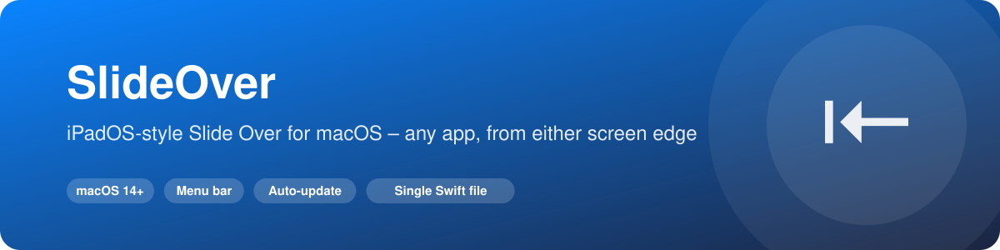
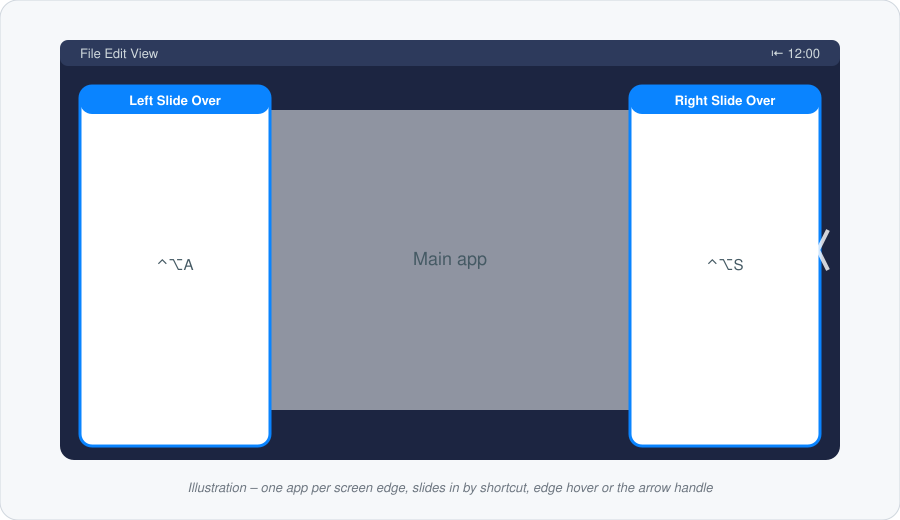

# SlideOver

**English** · [Deutsch](README.de.md)

[](https://github.com/dr-apple/SlideOver/releases/latest)



iPadOS-style **Slide Over** for macOS – a tiny menu bar app that lets any Mac app slide in from the edge of the screen, just like on the iPad.



## Features

- **Two Slide Over apps – one per side**: assign one app to the left edge and one to the right edge
- Each slides in and out from its edge with an animation
- Remembers **position and size per side and app** – just move/resize the window, it'll come back exactly there
- **Arrow handle** at the screen edge (like on iPad) when Slide Over is stashed away or covered – it only fades in when the mouse comes near the edge and never shows over fullscreen apps (e.g. videos); click it to bring the app back
- Optional: show it by resting the mouse at the screen edge (~0.3 s, corners excluded so Hot Corners keep working; disabled over fullscreen apps)
- Optional: auto-hide when you switch to another app
- Launches the app if it isn't running yet
- **Starts at login** (on by default, toggle in the menu) and remembers both apps, positions and sizes across restarts
- **Auto-update**: checks GitHub Releases on launch and every 6 hours, downloads, replaces itself and relaunches (can be turned off in the menu)
- No dependencies, a single Swift file, no Xcode project needed

## Shortcuts

| Shortcut | Action |
|---|---|
| `⌃⌥⇧S` | Make the frontmost app the **right** Slide Over app (and show it) |
| `⌃⌥S` | Show / hide the **right** Slide Over |
| `⌃⌥⇧A` | Make the frontmost app the **left** Slide Over app (and show it) |
| `⌃⌥A` | Show / hide the **left** Slide Over |

Everything else (apps per side, size, handle, edge trigger, auto-hide, updates) is in the menu bar icon.

## Build & install

Requires macOS 14+ and the Xcode Command Line Tools (`xcode-select --install`).

```bash
./build.sh install
```

This builds `SlideOver.app`, copies it to `~/Applications` and launches it.

Or download the ZIP from [Releases](https://github.com/dr-apple/SlideOver/releases), move `SlideOver.app` to `~/Applications` and run `xattr -dr com.apple.quarantine ~/Applications/SlideOver.app` once (the app isn't notarized).

On first launch, grant **Accessibility** access (System Settings → Privacy & Security → Accessibility). The app needs it to move and resize other apps' windows.

> **Note:** The app is ad-hoc signed, so after each update/rebuild macOS treats it as a new app. After an auto-update SlideOver resets its own Accessibility entry so macOS asks again – just allow it. After a manual rebuild, remove the SlideOver entry under Accessibility with “–”, relaunch and grant access again.

## Example: a typical setup

1. Open **Messages** and press `⌃⌥⇧A` – Messages becomes the left Slide Over app.
2. Open **Music** and press `⌃⌥⇧S` – Music becomes the right Slide Over app.
3. Resize/move both once to taste – SlideOver remembers it.
4. From now on `⌃⌥A` / `⌃⌥S` (or resting the mouse at the edge, if enabled) bring them in and out over whatever you're working on.

## Troubleshooting

| Problem | Fix |
|---|---|
| Windows don't move | Accessibility access missing – System Settings → Privacy & Security → Accessibility → enable SlideOver. |
| "App is damaged / can't be opened" | Run `xattr -dr com.apple.quarantine ~/Applications/SlideOver.app` once. |
| Access was granted but nothing happens after an update | Remove SlideOver under Accessibility with "–", relaunch, allow again. |

## Releasing a new version

```bash
./release.sh 1.2.0
```

Builds the app, commits, tags, pushes and creates a GitHub Release with the ZIP. Installed copies update themselves.

## Limitations

- macOS doesn't allow keeping another app's window permanently on top without system-level hacks, so Slide Over hides (or shows the handle) when you click another app.
- Apps with a minimum window width won't get narrower than that.
- The edge trigger doesn't fire on an edge that borders another display.

---

Not affiliated with Apple. "Slide Over" is an iPadOS feature name used here only to describe the behaviour.
